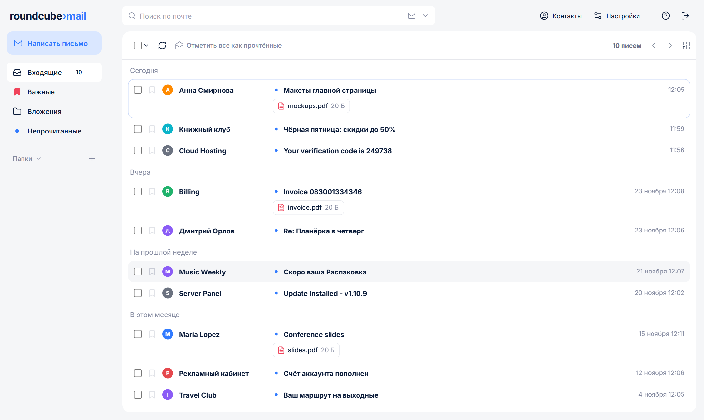
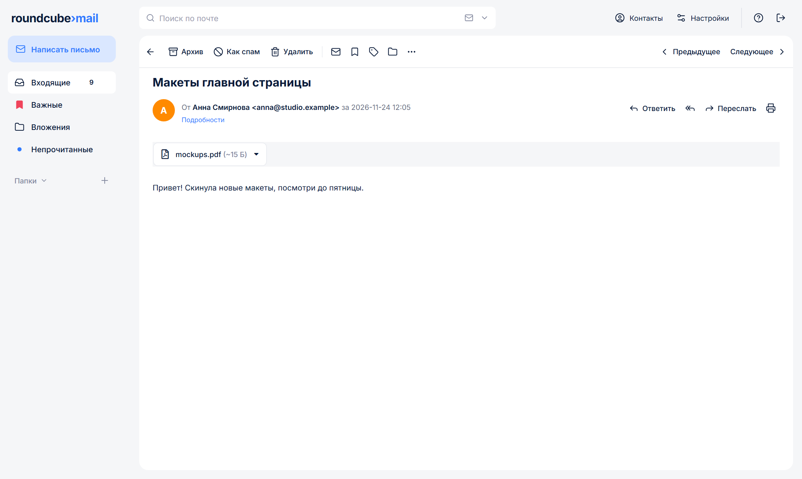
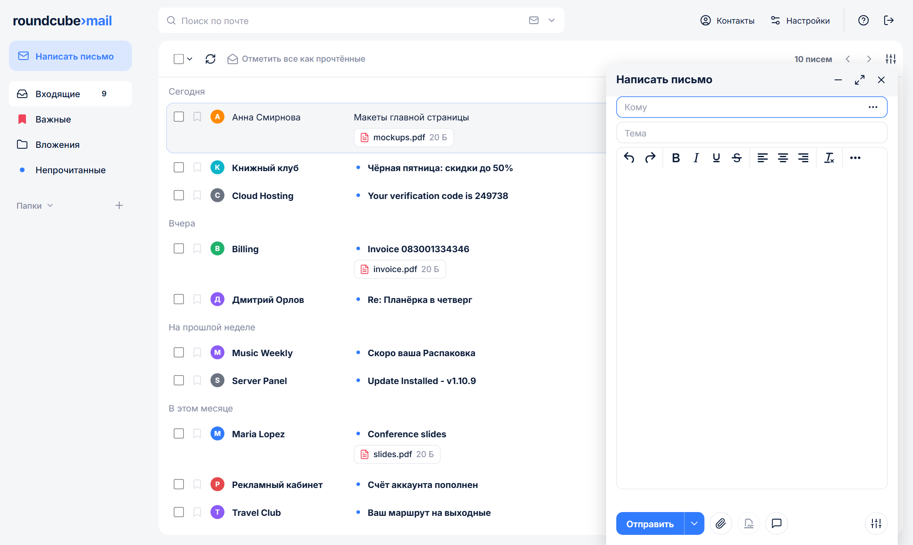
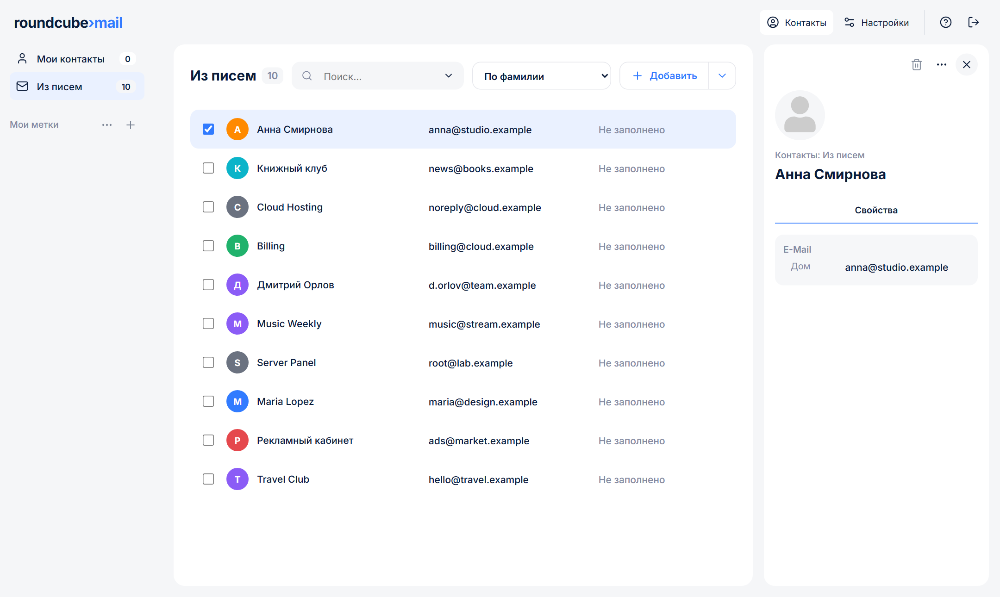
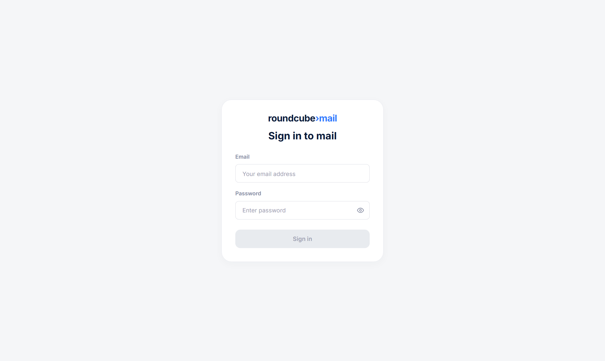
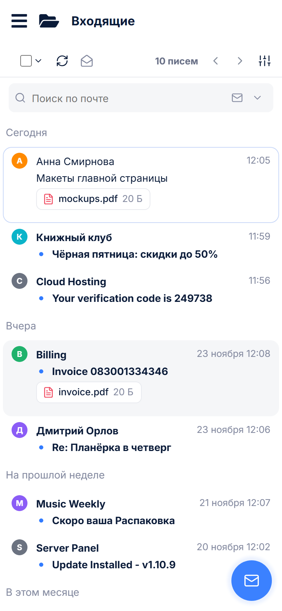

<div align="center">

# 🌬️ Breeze — a light, modern Roundcube skin

**A clean webmail UI: date-grouped messages, avatars, attachment chips, a floating compose window and a phone layout.**

[](https://roundcube.net)
[](plugins/tw_folders)
[](docker-compose.yml)
[](plugins/tw_folders/localization)
[](#-screenshots)
[](LICENSE)

[🇷🇺 Русский](README.md) · 🇬🇧 English



</div>

---

## ✨ Features

| | |
|---|---|
| 📬 **Message list** | "Today / Yesterday / Last week…" groups, avatars, bookmarks, attachment chips under the row (click to download), checkboxes and an action bar on selection |
| 📖 **Reading** | Open a message in place of the list, on the right or below (drag the divider, it is remembered), Previous / Next |
| ✍️ **Compose** | Floating panel: minimize, maximize, close with a save-draft prompt. Replies, forwards and drafts open there too |
| 🗂️ **Folders** | Custom icons and colors, a "Create folder" dialog, "⋮ → Edit / Delete", quick filters Flagged, With attachments, Unread |
| ⚡ **Rules** | "From / To / Subject contains → move to folder". No ManageSieve needed: Roundcube runs the rules when it checks mail |
| 👥 **Contacts** | Contacts panel in the header, a read-only "From mail" book (people from recent mail), one-click "Add to contacts", a table with your own labels |
| 🔀 **Multi-account** | Several mailboxes in one session via [ident_switch](https://packagist.org/packages/gecka/ident-switch) |
| 🌍 **Languages** | Russian and English; the login page remembers the browser's language |
| 📱 **Phone** | Panels switch, two-line messages, a floating Compose button, full-screen compose |

## 📸 Screenshots

<table>
<tr>
<td width="50%"><br><sub>📖 Reading a message</sub></td>
<td width="50%"><br><sub>✍️ Compose in a floating panel</sub></td>
</tr>
<tr>
<td><br><sub>👥 Contacts: the "From mail" book and a contact card</sub></td>
<td><br><sub>🔐 Sign-in page</sub></td>
</tr>
</table>

<p align="center"><br><sub>📱 On a phone</sub></p>

> Screenshots were taken on a GreenMail test server with made-up mail from [`seed.py`](seed.py). The UI language follows the user's Roundcube setting.

## 🚀 Quick start

You need Docker and Docker Compose (Docker in WSL works on Windows).

```bash
git clone https://github.com/qdpops/roundcube-skin-breeze.git
cd roundcube-skin-breeze

# 1. Session encryption key: 24 random characters
cp config/des_key.inc.php.dist config/des_key.inc.php
sed -i "s|change-me-24-characters!|$(openssl rand -base64 18)|" config/des_key.inc.php

# 2. Put your mail provider's IMAP and SMTP into docker-compose.yml
#    (ROUNDCUBEMAIL_DEFAULT_HOST / _PORT, ROUNDCUBEMAIL_SMTP_SERVER / _PORT)
#    and into plugin-config/ident_switch.inc.php for extra mailboxes.
#    For English by default set $config['language'] = 'en_US' in config/custom.inc.php

# 3. Run
docker compose up -d
```

Open **http://localhost:8090** and sign in with your mailbox address and password.

<details>
<summary>🧪 Try it without a real mailbox</summary>

1. In `docker-compose.yml` set `greenmail` / `3143` (IMAP) and `greenmail` / `3025` (SMTP) in `ROUNDCUBEMAIL_*`.
2. `docker compose --profile test up -d`
3. Fill the mailbox: `python3 seed.py`
4. Sign in as `demo@local.test` with any password.

</details>

<details>
<summary>🪟 Windows + WSL notes</summary>

- Docker in WSL is often root-only: `wsl -d Ubuntu -u root -- bash -lc "cd /mnt/c/path/to/project && docker compose up -d"`.
- WSL shuts the distro down when no session is open, which stops the containers. Keep a WSL window open while you work (or run `wsl -d Ubuntu -- sleep infinity`).
- opcache does not notice PHP edits on `/mnt/c`: after changing configs or PHP run `docker restart <roundcube container>`. CSS, JS and templates reload right away.

</details>

## 🧩 How it works

```
skins/breeze/            the skin: templates, styles/breeze.css, breeze.js, icons
  styles/elastic-palette.css   Elastic colors mapped to the Breeze palette (tools/make_palette.py)
  tools/make_icons.py          icon generator (Lucide paths)
plugins/tw_folders/      companion plugin: folder icons and colors, rules, attachments in the list,
                         contacts from mail, localization (ru_RU, en_US)
config/custom.inc.php    language, skin, folders, date format
plugin-config/           servers for extra ident_switch accounts
docker-compose.yml       Roundcube 1.6.11 + GreenMail test server (profile "test")
```

- The skin extends **Elastic** only for its scripts: popups, dialogs and phone panel switching. The look is entirely its own.
- All skin labels live in `plugins/tw_folders/localization`. Other languages fall back to English; add one by copying `en_US.inc`.
- After a Roundcube upgrade, regenerate the palette: `python3 skins/breeze/tools/make_palette.py`.

## 🛠️ Compatibility

- Roundcube **1.6.x** (tested on 1.6.11), PHP 8, SQLite, MySQL or PostgreSQL.
- Plugins used with the Docker image: `archive`, `markasjunk`, `zipdownload`, `newmail_notifier`, `ident_switch`.
- No dark mode yet.

## 🤝 Contributing

Issues and pull requests are welcome: bugs, translations, new languages, a dark theme.

## 📄 License

[GPL-3.0](LICENSE), same as Roundcube. Icons use [Lucide](https://lucide.dev) paths (ISC).
The layout is inspired by Timeweb Mail.

<div align="center"><sub>Made with ☕ and Roundcube</sub></div>
