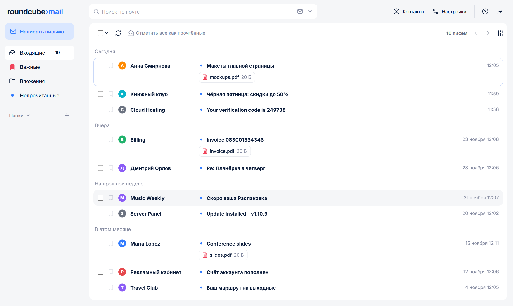
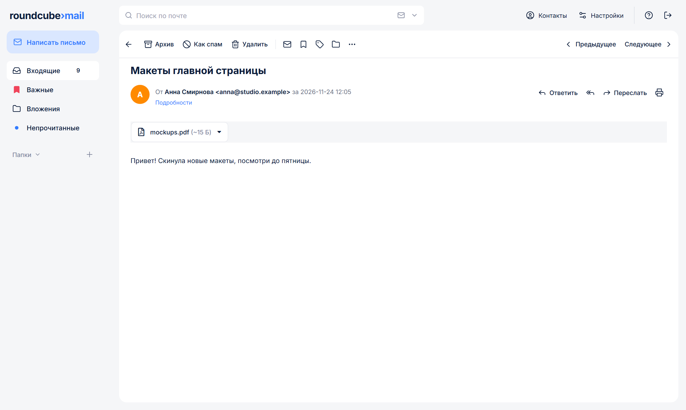
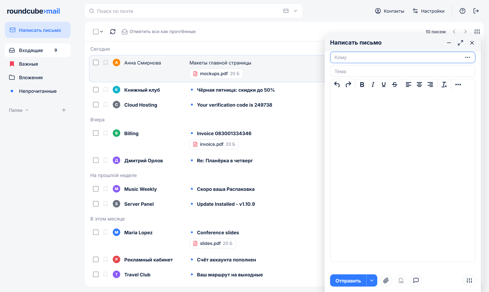
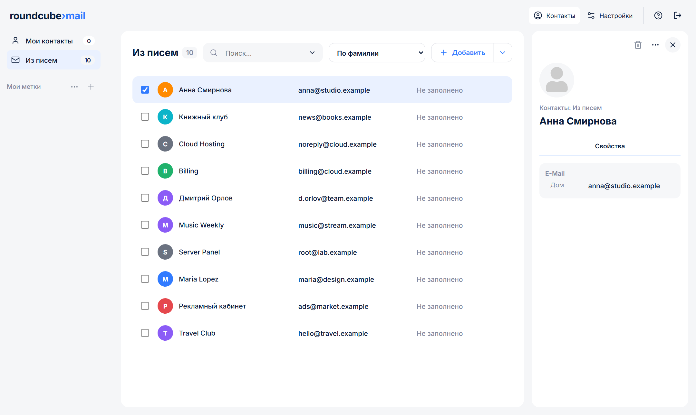
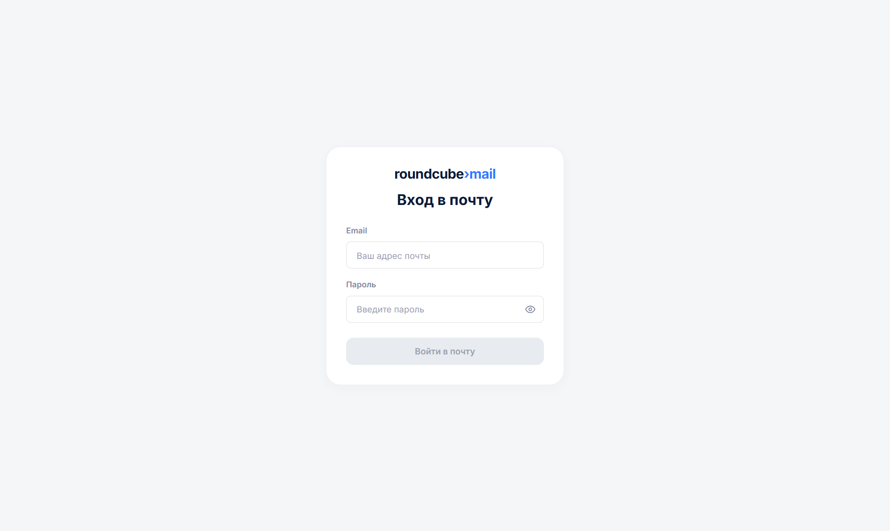
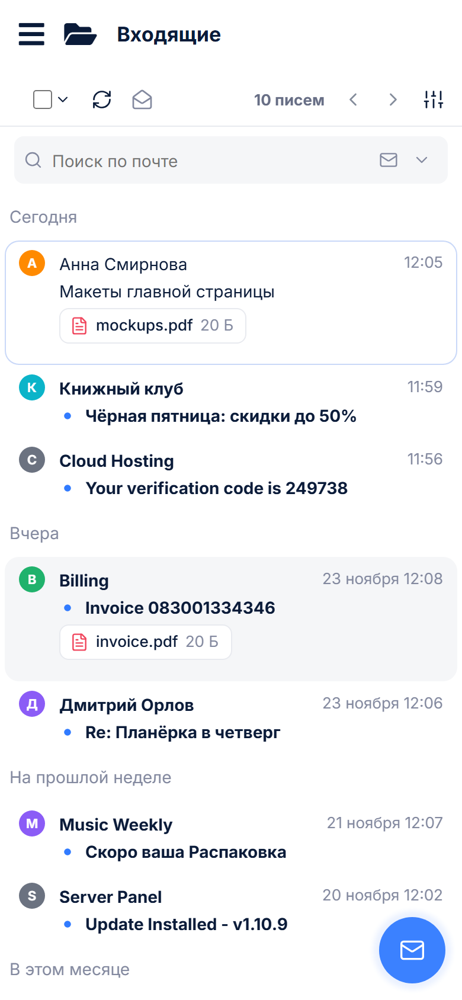

<div align="center">

# 🌬️ Breeze — лёгкий современный скин для Roundcube

**Чистый интерфейс веб-почты: группы писем по датам, аватары, чипы вложений, плавающее окно нового письма и раскладка для телефона.**

[](https://roundcube.net)
[](plugins/tw_folders)
[](docker-compose.yml)
[](plugins/tw_folders/localization)
[](#-скриншоты)
[](LICENSE)

🇷🇺 Русский · [🇬🇧 English](README.en.md)



</div>

---

## ✨ Возможности

| | |
|---|---|
| 📬 **Список писем** | Группы «Сегодня / Вчера / На прошлой неделе…», аватары, закладки, чипы вложений под строкой (клик скачивает), чекбоксы и панель действий при выделении |
| 📖 **Чтение** | Письмо открывается на месте списка, справа или снизу (граница перетаскивается и запоминается), «Предыдущее / Следующее» |
| ✍️ **Новое письмо** | Плавающая панель: свернуть, развернуть, закрыть с сохранением черновика. Ответ, пересылка и черновики открываются там же |
| 🗂️ **Папки** | Свои иконки и цвета, окно «Создать папку», «⋮ → Редактировать / Удалить», быстрые фильтры «Важные», «Вложения», «Непрочитанные» |
| ⚡ **Правила** | «От / Кому / Тема содержит → переместить в папку». Работают без ManageSieve: правила выполняет сам Roundcube при проверке почты |
| 👥 **Контакты** | Панель контактов в шапке, книга «Из писем» (люди из последних писем, только чтение), «Добавить в контакты» одной кнопкой, таблица со своими метками |
| 🔀 **Мультиаккаунт** | Несколько ящиков в одной сессии через [ident_switch](https://packagist.org/packages/gecka/ident-switch) |
| 🌍 **Языки** | Русский и английский; страница входа помнит язык браузера |
| 📱 **Телефон** | Панели переключаются, письма в две строки, кнопка «Написать» внизу, новое письмо на весь экран |

## 📸 Скриншоты

<table>
<tr>
<td width="50%"><br><sub>📖 Чтение письма</sub></td>
<td width="50%"><br><sub>✍️ Новое письмо в плавающей панели</sub></td>
</tr>
<tr>
<td><br><sub>👥 Контакты: книга «Из писем» и карточка</sub></td>
<td><br><sub>🔐 Страница входа</sub></td>
</tr>
</table>

<p align="center"><br><sub>📱 На телефоне</sub></p>

> Скриншоты сняты на тестовом сервере GreenMail с выдуманными письмами из [`seed.py`](seed.py).

## 🚀 Быстрый старт

Нужны Docker и Docker Compose (на Windows подойдёт Docker в WSL).

```bash
git clone https://github.com/qdpops/roundcube-skin-breeze.git
cd roundcube-skin-breeze

# 1. Ключ шифрования сессий: 24 случайных символа
cp config/des_key.inc.php.dist config/des_key.inc.php
sed -i "s|change-me-24-characters!|$(openssl rand -base64 18)|" config/des_key.inc.php

# 2. Укажите IMAP и SMTP своего почтового провайдера в docker-compose.yml
#    (ROUNDCUBEMAIL_DEFAULT_HOST / _PORT, ROUNDCUBEMAIL_SMTP_SERVER / _PORT)
#    и в plugin-config/ident_switch.inc.php для дополнительных ящиков

# 3. Запуск
docker compose up -d
```

Откройте **http://localhost:8090** и войдите адресом ящика и его паролем.

<details>
<summary>🧪 Попробовать без настоящей почты</summary>

1. В `docker-compose.yml` поставьте `greenmail` / `3143` (IMAP) и `greenmail` / `3025` (SMTP) в `ROUNDCUBEMAIL_*`.
2. `docker compose --profile test up -d`
3. Наполните ящик: `python3 seed.py`
4. Войдите как `demo@local.test` с любым паролем.

</details>

<details>
<summary>🪟 Заметки для Windows + WSL</summary>

- Docker в WSL часто доступен только root: `wsl -d Ubuntu -u root -- bash -lc "cd /mnt/c/путь/к/проекту && docker compose up -d"`.
- WSL выключает дистрибутив без открытых сессий, и контейнеры останавливаются. Пока работаете, держите окно WSL открытым (или `wsl -d Ubuntu -- sleep infinity`).
- opcache не замечает правок PHP на `/mnt/c`: после изменения конфигов или PHP выполните `docker restart <контейнер roundcube>`. CSS, JS и шаблоны подхватываются сразу.

</details>

## 🧩 Как устроено

```
skins/breeze/            скин: шаблоны, styles/breeze.css, breeze.js, иконки
  styles/elastic-palette.css   цвета Elastic в палитре Breeze (tools/make_palette.py)
  tools/make_icons.py          генератор иконок (пути Lucide)
plugins/tw_folders/      плагин скина: иконки и цвета папок, правила, вложения в списке,
                         контакты из писем, локализация (ru_RU, en_US)
config/custom.inc.php    язык, скин, папки, формат дат
plugin-config/           серверы для дополнительных аккаунтов ident_switch
docker-compose.yml       Roundcube 1.6.11 + тестовый GreenMail (профиль test)
```

- Скин наследует **Elastic** только ради его скриптов: всплывающих меню, диалогов и переключения панелей на телефоне. Внешний вид полностью свой.
- Все надписи скина лежат в `plugins/tw_folders/localization`. Для других языков показывается английский; новый язык добавляется копией `en_US.inc`.
- После обновления Roundcube перегенерируйте палитру: `python3 skins/breeze/tools/make_palette.py`.

## 🛠️ Совместимость

- Roundcube **1.6.x** (проверено на 1.6.11), PHP 8, SQLite, MySQL или PostgreSQL.
- Плагины в комплекте Docker-образа: `archive`, `markasjunk`, `zipdownload`, `newmail_notifier`, `ident_switch`.
- Тёмной темы пока нет.

## 🤝 Участие

Issues и pull requests приветствуются: баги, переводы, новые языки, тёмная тема.

## 📄 Лицензия

[GPL-3.0](LICENSE), как и Roundcube. Иконки сделаны по путям [Lucide](https://lucide.dev) (ISC).

<div align="center"><sub>Сделано с ☕ и Roundcube</sub></div>
